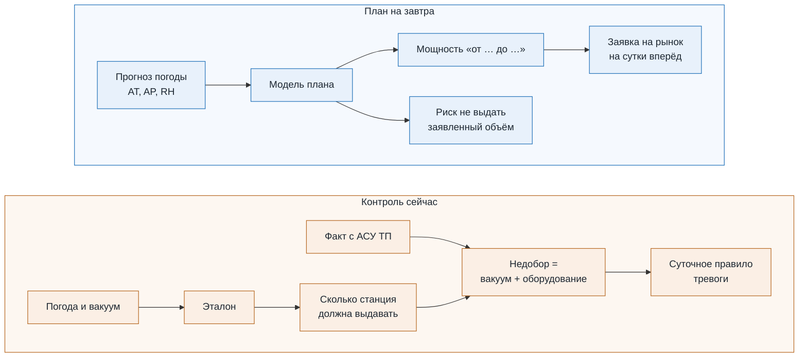

# Эталон мощности ПГУ

Прогноз электрической мощности парогазовой установки по погоде и вакууму и определение того, какие параметры влияют на неё сильнее всего. Решение кейса 9 «Прогнозирование выработки электроэнергии на электростанции».

Модель отвечает на вопрос, сколько станция **должна** выдавать при такой погоде, и работает в двух режимах:

- **План на завтра.** Модель без вакуума: его завтрашнего значения никто не знает. По прогнозу погоды она даёт мощность с диапазоном «от … до …» и риск не выдать заявленный объём.
- **Контроль сейчас.** Модель со всеми параметрами. По фактической погоде, вакууму и мощности она раскладывает недобор на «вакуум хуже обычного» и «не объясняется погодой и вакуумом».



## Быстрый старт

Нужен Python 3.11 или новее.

```bash
python3 -m venv .venv
.venv/bin/python -m pip install -r requirements.txt
.venv/bin/python scripts/train.py
.venv/bin/python -m uvicorn powerplant.api:create_app --factory --port 8001
```

Затем откройте <http://localhost:8001>. Описание API: <http://localhost:8001/docs>.

Обученная модель уже лежит в `models/bundle.joblib`, поэтому шаг с `train.py` можно пропустить. Если файл не загрузится (другая версия библиотек), переобучите: первое обучение с подбором гиперпараметров занимает 10–15 минут. Подобранные параметры сохраняются в `models/tuned_params.json`, поэтому повторный запуск быстрее. Чтобы подобрать параметры заново, запустите `scripts/train.py --retune`.

## Что внутри

| Путь | Что это |
|---|---|
| `data/` | Данные UCI и их описание, см. [data/README.md](data/README.md) |
| `powerplant/` | Пакет с логикой: данные, разведка, модели, диапазон, новизна, детектор, экономика, API |
| `powerplant/web/index.html` | Страница: ползунки, сценарии, пакетный прогноз. Работает без интернета |
| `scripts/train.py` | Полный прогон обучения: метрики в `models/metrics.json`, модель в `models/bundle.joblib` |
| `scripts/economics_table.py` | Собирает `reports/economics.xlsx`: экономика в макете шаблона ментора |
| `notebooks/research.ipynb` | Исследование: разведка, лестница моделей, важность признаков, диапазон, стресс-тест, детектор, проверка решений, экономика |
| `reports/decisions.md` | Журнал решений по данным |
| `reports/evidence.json` | Результаты статистических проверок решений сверх кейса |
| `reports/economics.xlsx` | Экономика: исходные данные с источниками, расчёт, чувствительность, график окупаемости |
| `reports/figures/` | Графики |
| `slides/` | Презентация |
| `tests/` | Тесты |

## Как устроено

1. **Данные.** В исходном Excel пять листов, и это одни и те же 9 568 строк в разном порядке. Берём один экземпляр, убираем 41 дубль. Склеивать листы нельзя: почти каждая строка проверки окажется в обучении.
2. **Разведка до разбиения.** Распределения, выбросы, связи, мультиколлинеарность, частные корреляции, покрытие пространства признаков. Находки записаны в журнал решений до обучения.
3. **Проверка.** 20% данных отложены в тест (стратификация по мощности) и использованы один раз, для итоговой таблицы. Гиперпараметры подбираются на 5-fold CV по обучающей части.
4. **Лестница моделей.** Константа → линейная → полином с Ridge → случайный лес → градиентный бустинг → стекинг. Модель выбирается правилом: самая простая, чей RMSE на CV не хуже лучшего более чем на 5%, среди тех, что не нарушают физику: мощность не растёт с жарой ни на одном срезе по остальным параметрам. Бустинг получает ограничение монотонности по температуре: жарче — мощность не растёт.
5. **Важность признаков** тремя способами: сгруппированная перестановочная важность (пара AT и V сильно связана), частичная зависимость, линейные коэффициенты. Вклад параметров в конкретный прогноз считается точными значениями Шепли.
6. **Диапазон «от … до …»** — конформный, по внефолдовым остаткам, с проверкой покрытия на тесте и по срезам.
7. **Предупреждение о новизне.** Срабатывает, если параметр вне диапазона данных или если сочетание параметров в данных не встречалось.
8. **Детектор.** Тревога по среднему отклонению факта от эталона за сутки, порог даёт 1% ложных суточных окон на здоровой станции.
9. **Проверка решений сверх кейса.** Парный t-тест и критерий Уилкоксона на тесте, проверка 5×2 с t-тестом Диттериха на листах авторов. Результаты ниже, в разделе «Обоснование решений».
10. **Экономика** по шаблону ментора: простои, цена часа простоя, сокращение простоев, затраты на внедрение и сопровождение. На примере из шаблона код выдаёт те же цифры, что и шаблон.

## Результаты

Отложенный тест — 20% данных (1 906 часов), модель его не видела.

| | План на завтра (без вакуума) | Эталон (с вакуумом) |
|---|---|---|
| Модель | градиентный бустинг | градиентный бустинг |
| RMSE / MAE на тесте | 4,31 / 3,33 МВт | 2,97 / 2,12 МВт |
| R² на тесте | 0,936 | 0,970 |
| Покрытие диапазона 90% на тесте | 90,8% | 91,1% |

- По протоколу авторов датасета (проверка 5×2 на их пяти листах) эталон даёт MAE 2,30 и RMSE 3,23 МВт, у лучшей модели статьи 2,82 и 3,79 (цифры статьи по обзору PMC10558780).
- Если склеить пять листов Excel, случайный лес без подбора параметров «ошибается» всего на 0,28 МВт по RMSE против честных 3,45: это утечка, а не точность.
- Суточное правило детектора замечает падение мощности от 0,75% (около 3,4 МВт). Это моделирование на остатках исправной станции: размеченных поломок в данных нет.
- Экономика для ПГУ-450 Ярославской ТЭС (463,9 МВт): при осторожной оценке, когда программа сокращает простои от недобора мощности всего на 1%, экономия после расходов на сопровождение 87 тыс. ₽ в месяц, окупаемость 3,6 месяца. За год внедрение окупается уже при сокращении на 0,39%. Недобор от загрязнения компрессора считаем только для газовых турбин блока.

Подробности — в `models/metrics.json`, `reports/economics.xlsx` и ноутбуке.

## Обоснование решений

Кейс просит прогноз мощности и ответ, что влияет на неё сильнее всего. Всё, что мы добавили сверх этого, проверено на отложенном тесте и проверкой 5×2 на листах авторов (раздел 8 ноутбука, `reports/evidence.json`).

| Решение | Как проверяли | Результат |
|---|---|---|
| Вакуум в модели контроля | Эталон с вакуумом против модели без него | MAE 2,12 против 3,33 МВт, p < 0,001; в проверке 5×2 тоже p < 0,001 |
| Нет вакуума в плане на завтра | Модель «вакуум по погоде → эталон» против модели плана | 3,36 против 3,33 МВт: прогноз вакуума по погоде план не улучшает (p = 0,23; в проверке 5×2 p = 0,12). Погода объясняет вакуум на 82% |
| Разложение недобора на вакуум и прочее | Согласованность: связь разницы «эталон − план» с отклонением вакуума от обычного для такой погоды (разница по построению зависит от вакуума) | корреляция −0,56, знак как в физике |
| Предупреждение о новизне | Разброс прогнозов четырёх моделей лестницы | в данных медиана 3,1 МВт, в зоне с предупреждением 55,7 МВт |
| Плотность воздуха и точка росы не используются | Модель плана с ними и без них, с ограничениями по физике и без | без ограничений ошибка ниже на 1,6%, но мощность растёт с жарой в 12 шагах сетки внутри данных; с ограничениями выигрыш 0,4%, ниже порога 1% |
| Плотность по уравнению Менделеева–Клапейрона, а не Ван-дер-Ваальса | Плотность по обоим уравнениям на тех же данных | поправка Ван-дер-Ваальса 0,06–0,09% при размахе плотности 15,8%; ошибка варианта модели плана с плотностью 4,3455 против 4,3480 МВт на CV |
| Риск не выполнить план | Заявленная вероятность недобора против доли недоборов на тесте | 5% → 4,6%, 10% → 10,8%, 25% → 24,9%, 50% → 50,6% в среднем по часам |
| Вакуум V — давление в конденсаторе в мм рт. ст. | Температура конденсации пара против температуры воздуха | в «см рт. ст.», как подписано, давление доходило бы до 109 кПа, выше атмосферного; в мм рт. ст. 3,4–10,9 кПа, конденсация в среднем на 20 °C теплее воздуха (раздел 2.6 ноутбука) |

Проверить, держится ли вакуум сутками (тогда его сегодняшнее значение помогло бы плану), на этих данных нельзя: в датасете нет времени. На реальной станции это первое, что стоит проверить.

## Проверка

```bash
.venv/bin/python -m pytest
.venv/bin/python -m pytest --cov=powerplant --cov-report=term-missing
.venv/bin/python -m ruff check .
```

Таблицу экономики пересобирает `.venv/bin/python scripts/economics_table.py`. Формулы в ней живые: Excel или LibreOffice пересчитает их при открытии.

## Ограничения

- Данные сняты только на полной нагрузке. Для частичной нагрузки модель не предназначена.
- Времени в данных нет, поэтому разбиение случайное, а строки считаются независимыми. На реальном потоке часы связаны между собой: покрытие диапазона и доля ложных тревог могут оказаться хуже заявленных.
- Диапазон описывает ошибку модели при точной погоде. В плане на завтра к ней добавляется ошибка прогноза погоды, её размер оценивает стресс-тест в ноутбуке.
- Для другой станции модель нужно переобучить на её данных, лучше за период после ремонта.
- Рубли в экономике — выручка, как в шаблоне ментора, а не прибыль. Источник каждой цифры и допущения (средний недобор за цикл, работа на полной нагрузке весь месяц, сокращение простоев, трудоёмкость внедрения, часы поддержки) — в `reports/economics.xlsx`. Аварийные остановы в расчёт не входят: мы их не прогнозируем.

## Данные и лицензия

UCI Machine Learning Repository, датасет 294 «Combined Cycle Power Plant», лицензия CC BY 4.0. Статья авторов: P. Tüfekci, International Journal of Electrical Power & Energy Systems, 2014, doi:10.1016/j.ijepes.2014.02.027.
